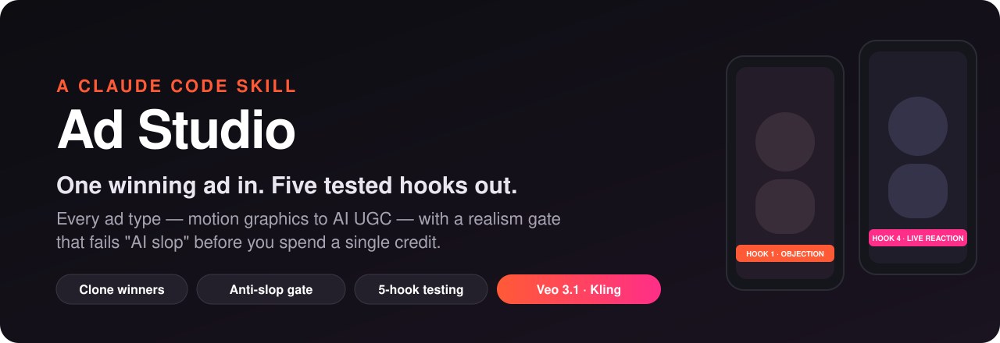
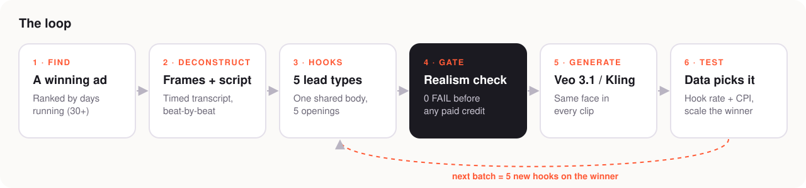
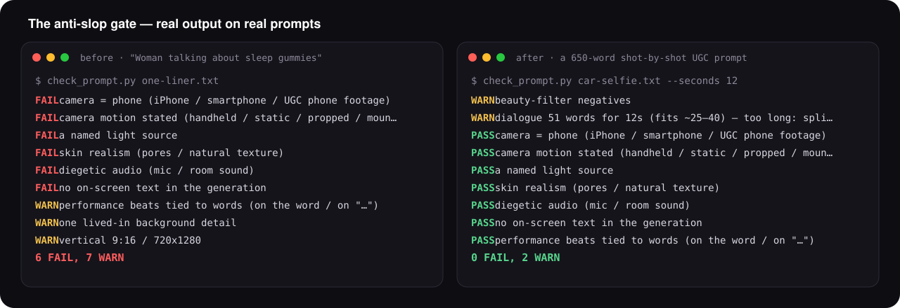
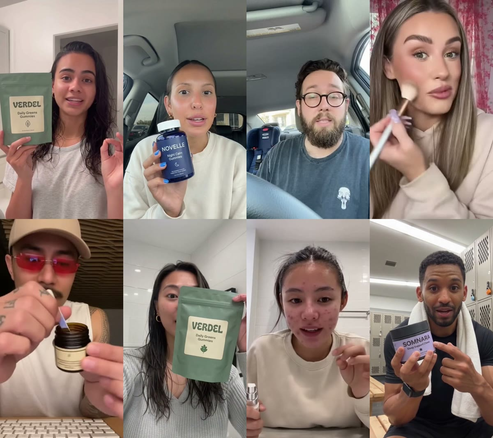
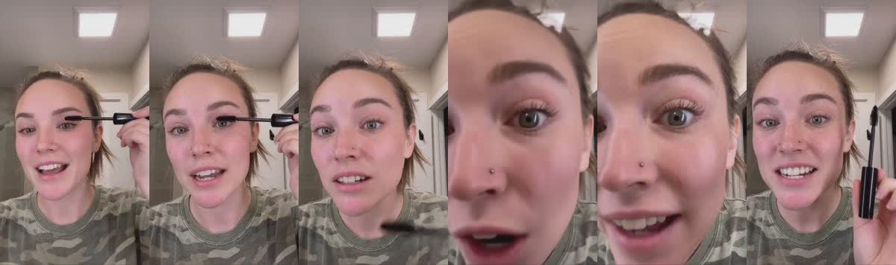

<p align="center">
  
</p>

<h3 align="center">Other AI ad tools generate first and hope.<br>Ad Studio <u>proves first</u> — then generates.</h3>

<p align="center">
  <b>① Starts from ads that are already winning</b> — pulled from the Meta Ad Library and ranked by <i>days running</i>, the one number advertisers can't fake.<br>
  <b>② Clones their timing, not their assets</b> — every winner is broken into frames + a timed transcript: when the hook lands, when the proof shows, when the CTA hits.<br>
  <b>③ Blocks "AI slop" before you pay</b> — a realism gate <b>fails</b> any video prompt that still has the tells viewers read as fake. No credit is spent on a prompt that fails.<br>
  <b>④ Ships 5 hooks, not 1 ad</b> — one body, five openings, a kill/scale plan. The data picks the winner, not taste.<br>
  <b>⑤ Runs on your Gemini subscription, not the API</b> — Veo 3.1 + Nano Banana through Google Flow on the account you're logged in to. No per-second video bills.
</p>

<p align="center">
  All inside one Claude Code conversation, for <b>every</b> ad type — motion graphics, app demos, AI UGC, AI podcasts, statics, copy.
</p>

<p align="center">
  
  
  
  
</p>

---

## Why this exists

Most AI ads fail for three boring reasons:

1. **They look AI.** Waxy skin, perfect light, a phone that never moves. Viewers can't say why — they just scroll.
2. **They're invented from scratch.** Someone's "great idea" instead of the structure of an ad that already sells.
3. **They're polished instead of tested.** Version 8 of one ad, when five different openings would have found the winner in a day.

Ad Studio fixes all three, inside Claude Code, in one conversation.

## Every ad type, one skill

It starts by asking what you want to make, then runs the right pipeline:

| Ad type | What you get |
|---|---|
| 🎬 **Motion-graphic / real-data promo** | Kinetic typography, real prices and product photos, voice-over, captions, music, end card — rendered to 9:16 with a QA contact sheet |
| 📱 **App demo ad** | Real screen recordings driven automatically, stitched into a hook → problem → solution → proof → CTA story |
| 🤳 **AI UGC** | A realistic creator talking to camera — deconstructed from a winner, 5 hooks, consistent face across clips |
| 🎙️ **AI podcast / two hosts** | Two-host "podcast clip" ads built from 8-second scenes with locked first/last frames |
| 🗣️ **Talking photo, AI animation, motion copy** | Image-to-lipsync, 3D mascot animations, copying a reference video's exact movement |
| 🖼️ **Static ads at scale** | Winning statics re-made for your product, one image prompt + copy each |
| ✍️ **Copy** | Hooks, primary text, captions + hashtags, advertorial pages (clearly labelled as ads) |


## What makes it different

| | What it does | Why it matters |
|---|---|---|
| 🧭 **Asks first, then routes** | One skill for every ad type — motion graphics, AI UGC, AI podcast, talking photo, statics, copy. It asks which one, then runs the right pipeline. | No more "which prompt/tool do I use?" |
| 🏆 **Finds the winners for you** | Pulls competitors' ads from the Meta Ad Library and ranks them by **days running** — the one metric advertisers can't fake, because nobody keeps paying for an ad that loses. Plus the course's sourcing playbook (Kalo Data by spend, raw TikToks, green/red flags). | You start from proof, not a guess. |
| 🔬 **Winner deconstructor** | Drop in any winning ad → frames + a timed transcript (99 languages) → a beat-by-beat table of *when* the hook lands, the proof shows, the CTA hits. | You copy what works — the timing — not a competitor's assets. |
| 🚫 **Anti-slop gate** | A checker that **fails** a video prompt missing the realism layers (light source, skin texture, camera motion, room audio, word-tied gestures) *before* you pay for a generation. | The 7 tells that make viewers feel "fake" get caught in text, not in a $1 render. |
| 🎯 **5 hooks by default** | Every ad ships as one shared body + five openings, one per lead type (objection, secret, myth-bust, live reaction, A/B), with a kill/scale test plan. | Hook swaps move cost per result 2–4×. Testing hooks is the cheapest win in ads. |
| 🧠 **Awareness-first copy** | Picks the opening by how aware the viewer is (Great Leads), flags the buyer (Hopkins), one idea per ad (Ogilvy), a reason why (Kennedy). | Classic direct response, applied to 15-second vertical video. |
| 🔐 **Your accounts, not APIs** | Generates through the accounts you're already logged in to (Google Flow for Veo 3.1 + Nano Banana). It never touches a pay-per-call API, even if a key is lying around. | Your subscription, your credits, no surprise bills. |
| 🛡️ **Your rules win** | Reads your brand + legal rules first (AI labels, "presenter, not testimony", real prices only) and obeys them over everything else. | Keeps ad accounts alive and the lawyers calm. |

## Runs on your Gemini subscription — not the API

Most AI video pipelines bill you per second through an API key. Ad Studio drives **Google Flow with the Google account you're already logged in to** — so Veo 3.1 video and Nano Banana images come out of your **Google AI Pro / Ultra (Gemini) subscription credits** instead of a pay-per-call bill.

| | API route (typical) | Ad Studio |
|---|---|---|
| Veo 3.1 Fast, 8 s, 1080p | ~$0.96 per clip, billed per second (our own API test) | included in your Google AI subscription credits |
| Nano Banana Pro image | ~$0.13 per image | included in your subscription credits |
| Setup | billing account, API keys, quotas | log in to Flow once |
| Surprise bills | possible | none — it stops instead of falling back to an API |

Under the hood it uses [gflow](https://github.com/ffroliva/gflow-cli), which drives Flow in your own browser session. Only text (ChatGPT) and voice (ElevenLabs) use keys, and those stay in a local `.env` that never leaves your machine.

## See it

<p align="center">
  
</p>

**The gate, on real prompts.** Left: the one-liner most people type. Right: a shot-by-shot UGC prompt in the format the skill writes.

<p align="center">
  
</p>

**The realism target.** Every face below is AI-generated — phone framing, one real light source, real skin, lived-in rooms, the product held like a person holds it:

<p align="center">
  <br>
  <sub>AI-generated test frames. Products shown (VERDEL, NOVELLE, SOMNARA) are invented brands, re-rendered with Nano Banana on a Google AI subscription.</sub>
</p>


**The deconstructor, on a 12-second "live first try" UGC ad** — one frame every 2 s, plus a timed transcript: the hook *"I hate putting mascara on on camera, but I want y'all to see this…"* runs 0.0–5.9 s, the payoff reaction lands at 6.0 s:

<p align="center">
  
</p>

## Install (30 seconds)

```bash
git clone <this-repo-url> ad-studio && cd ad-studio && ./install.sh
```

No git access? Unzip `ad-video-studio-SHARE.zip` into `~/.claude/skills/` — same thing.

Optional tools (macOS): `brew install ffmpeg uv yt-dlp` — for video deconstruction and transcripts.

Text + voice keys: copy `~/.claude/skills/ad-video-studio/.env.example` to `.env` in the same folder and add your OpenAI and ElevenLabs keys. Images and video run on the accounts you're logged in to — no keys needed.

## Use it — just talk

```text
make me an ad for my app
```
```text
here's a competitor ad that's been running for months: ~/Downloads/ref.mp4 — make ours like it
```
```text
give me 5 hooks for this script and a Veo prompt for each
```

It asks what kind of ad you want, reads your brand rules, and does the rest — stopping before anything that costs money or goes public.

## Get the most out of it

1. **Feed it a winner, not an idea.** An ad running 30+ days is proof. The skill copies its beat timing, not its words.
2. **Put your rules in the repo.** A `docs/marketing/` folder with brand, positioning and do-not-say rules — the skill reads it first and obeys it.
3. **Spend your effort on the character still.** Half the realism is decided before the video model runs. Approve the still, then batch.
4. **Never skip the gate.** `0 FAIL` before any paid clip.
5. **Iterate hooks, not polish.** Launch all five, judge on hook rate and cost per result, then make five new hooks on the winner.

## What's inside

```
skill/ad-video-studio/
├── SKILL.md                    # the router + your production pipeline (edit, captions, voice, QA, delivery)
├── scripts/                    # research (ad library), TTS, contact sheets, audio finish, Meta-safe export
├── templates/                  # 9:16 composition template
└── ugc/
    ├── UGC.md                  # AI UGC workflow: format → deconstruct → hooks → still → prompt → gate → test
    ├── scripts/
    │   ├── deconstruct_video.py   # frames + contact sheet + timed transcript of any ad
    │   └── check_prompt.py        # the anti-slop gate
    └── references/             # formats menu, hook library, realism checklist, prompt formula,
                                # 25-scenario catalog, copy principles, advertorial skeleton
```

## FAQ

**How do I make AI UGC ads without paying for an API?** Install the skill, log in to Google Flow once, and ask Claude Code for an ad. Veo 3.1 and Nano Banana run on your Google AI (Gemini) subscription.

**Is this an Arcads / Creatify / MakeUGC / HeyGen alternative?** Those rent you a library of avatars for a monthly fee. Ad Studio starts one step earlier — it finds what's already winning in your market, clones its structure, and generates with the tools you already pay for.

**Does it only do UGC?** No. Motion-graphic promos, app-demo ads, AI podcasts, talking photos, AI animation, static ads and ad copy all run through the same skill.

**Which models?** Veo 3.1 for video, Nano Banana (Gemini image) for stills and product shots, Kling for motion transfer, ChatGPT for lines, ElevenLabs for voice. Whisper transcribes references in 99 languages.

**Will my ads look AI?** The anti-slop gate blocks the usual tells (waxy skin, perfect light, a phone that never moves, dead eyes, silent rooms). Realism still depends on your still image — the skill spends half its effort there.

## Honest limits

- It writes prompts and runs your generators — it doesn't replace your ad account, your offer, or your judgment.
- Realism is a moving target; the checklist is tuned to Veo 3.1 / Nano Banana / Kling 2.x as of late 2026.
- It ships tuned to its author's taste (the hard rules in `SKILL.md`). Change them — it will follow yours.
- It will not help with fake doctors, fake reviews, cloned real people, cloaking, or fake news-site pages. That's a feature.

---

<p align="center"><b>If this saves you one bad ad, it paid for itself. ⭐ Star it so you can find it again.</b></p>
